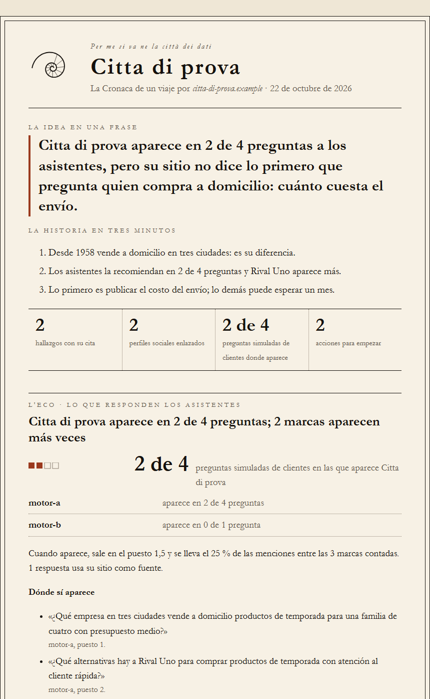
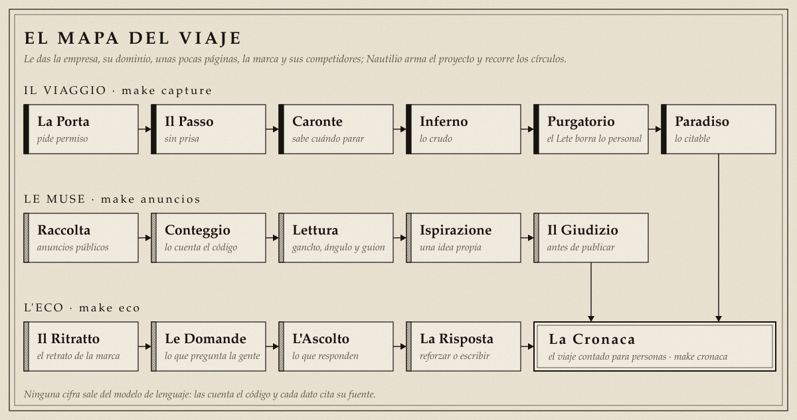
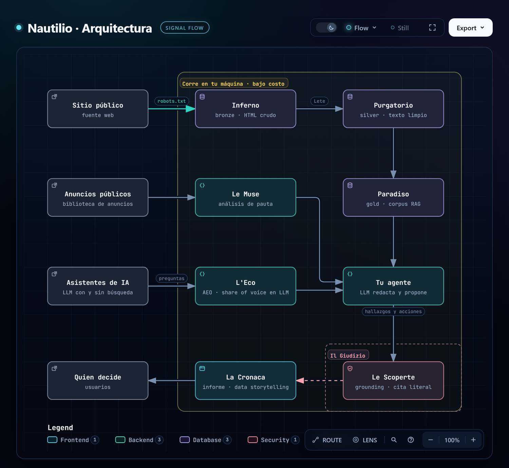

<p align="center">
    
</p>

<p align="center">
    
</p>

<p align="center">
    
    <a href="https://skills.sh/nautilio/nautilio"></a>
    
    
    
    
    <a href="LICENSE"></a>
</p>

<p align="center">
    <a href="#el-viaje"><strong>El viaje</strong></a>
    &middot;
    <a href="#la-arquitectura"><strong>La arquitectura</strong></a>
    &middot;
    <a href="#el-mapa"><strong>El mapa</strong></a>
    &middot;
    <a href="#instalación"><strong>Instalación</strong></a>
    &middot;
    <a href="#uso"><strong>Uso</strong></a>
    &middot;
    <a href="#le-leggi"><strong>Le leggi</strong></a>
</p>

> *Per me si va ne la città dei dati.*

**Nautilio** es una skill de agente. Le das una empresa, su dominio, unas pocas páginas
y la marca que quieres leer, y arma un proyecto que recorre los datos públicos círculo por
círculo: entra por la puerta, baja sin prisa, deja lo personal en el río del
olvido y sale con lo que se puede citar.

Al final te entrega **La Cronaca**: un informe que abre con la idea en una frase, muestra qué
dicen de la marca los asistentes de IA y termina con qué hacer primero. Cada hallazgo trae la
frase exacta del sitio que lo sostiene. Así se ve la del viaje de prueba, que corres en tu
máquina en segundos y sin internet:

<p align="center">
    
</p>

## El viaje

Nautilio tiene tres brazos.

- **Il Viaggio** (`make capture`): baja del sitio público solo lo que tiene permiso de
  bajar, lo limpia y lo deja citable, página por página y con su fuente.
- **Le Muse** (`make anuncios`): lee los anuncios públicos de una marca para aprender de
  sus ganchos, ángulos y guiones. *Inspírate, no copies.*
- **L'Eco** (`make eco`): escucha lo que los asistentes de IA responden sobre la marca.
  Mide si la recomiendan, si usan su sitio como fuente y en qué preguntas gana la
  competencia, y dice si el Paradiso ya tiene la página que responde.

Los tres desembocan en **La Cronaca** (`make cronaca`): un informe en tinta sobre papel que
se abre en el navegador y se imprime como PDF. Primero la idea y la historia en tres minutos;
después la tensión (qué dicen los asistentes), la evidencia (el sitio, cómo se ve al
compartirlo, qué anuncia) y la resolución: acciones en orden, con esfuerzo y plazo.

<p align="center">
    
</p>

## La arquitectura

<p align="center">
    
</p>

El sitio público pasa por el Inferno (bronze), cruza el Lete en el Purgatorio (silver) y llega
al Paradiso (gold), que sirve como corpus para RAG. Le Muse y L'Eco suman la pauta y lo que
dicen los asistentes. Tu agente redacta hallazgos y acciones, y Le Scoperte solo deja pasar
lo que tiene cita literal en el sitio.

## El mapa

| Nombre | Qué hace |
|---|---|
| **La Porta** | Pide permiso antes de entrar. Si el sitio no lo da, no entra. |
| **Il Passo** | Avanza sin prisa, una página a la vez. |
| **Caronte** | Sabe cuándo parar: si el sitio niega el paso, el viaje termina. |
| **Inferno** | Lo crudo, tal como llegó. |
| **Purgatorio** | Lo limpio. Aquí corre el **Lete**, el río del olvido, que borra los datos personales. |
| **Registro del Lete** | Cuenta cuánto borró el Lete y dónde. |
| **Paradiso** | Lo citable: cada línea con su fuente. |
| **Limbo** | Lo que no se puede leer sin un navegador espera revisión humana. |
| **Raccolta · Conteggio · Lettura · Ispirazione** | Los cuatro pasos de Le Muse: recoger, contar, leer e inventar algo propio. |
| **Il Ritratto** | El retrato de la marca: contexto, foco y cómo quiere ser descrita. |
| **Le Domande** | Las preguntas que hace la gente, sin nombrar la marca. |
| **L'Ascolto** | Lo que responden los asistentes, contado por el código. |
| **La Risposta** | Cada brecha cruzada con el Paradiso y lo que conviene hacer primero. |
| **Le Scoperte** | Los hallazgos. Si su cita no está en el sitio, no pasan. |
| **Lo Specchio** | El sitio visto desde las redes: la vista previa y los perfiles que enlaza. |
| **La Cronaca** | El viaje contado para personas. |
| **Il Giudizio** | La revisión final antes de publicar nada (`make check`). |

## Instalación

Copia la carpeta `skills/nautilio/` dentro de la carpeta de skills de tu agente. No necesita
dependencias de Node.

```bash
cp -r skills/nautilio <carpeta-de-skills-de-tu-agente>/nautilio
```

En Windows, copia la carpeta con el Explorador o con `Copy-Item` de PowerShell.

## Uso

Invoca la skill y describe el viaje:

```text
@nautilio

Empresa:   Empresa Demo
Dominio:   ejemplo.com
Semillas:  https://ejemplo.com/
           https://ejemplo.com/quienes-somos
Marca:     competidor-demo
Competidores: rival-uno, rival-dos
Destino:   ./empresa-demo
Contacto:  tu-correo@tu-dominio.edu   (el tuyo, nunca uno de la empresa)
```

Nautilio arma el proyecto y, antes de pedirte nada más, te muestra el viaje completo.

### El primer encuentro

Con uv instalado, monta un proyecto de prueba y corre la demo:

```bash
python skills/nautilio/scripts/montar_pipeline.py --empresa "Empresa Demo" --dominio ejemplo.com --path ./empresa-demo
cd empresa-demo
uv sync
make demo
```

Sin `make` (por ejemplo en Windows), el último paso es `uv run empresa_demo demo`. Después de
instalar las dependencias, la demo no usa internet: en unos segundos Nautilio recorre una
ciudad de prueba en tu propia máquina y te cuenta lo que pasó:

```text
La Porta     dejó pasar 2 páginas y cerró 1 que el sitio prohíbe
Caronte      negó el paso y detuvo el viaje; 1 página quedó sin visitar
Purgatorio   el Lete borró 4 datos personales: 2 correos, 1 teléfono y 1 identificación
Paradiso     2 documentos citables en data/demo/gold, con su fuente
Le Scoperte  2 hallazgos con su cita; 1 descartado porque su cita no está en el sitio
Le Muse      6 anuncios: 4 creativos únicos y 2 repetidos
L'Eco        la marca aparece en 2 de 4 preguntas (50 %); share of voice 25 %
La Cronaca   el viaje contado para personas: data/demo/gold/cronaca.html
```

Abre `data/demo/gold/cronaca.html` en el navegador: así se ve el entregable. Después es tu
turno: pon tu correo, elige páginas reales que den permiso y corre `make capture`.

## Le leggi

- Se pide permiso antes de entrar y se respeta el «no».
- Quien viaja se identifica con su propio nombre y nunca se disfraza.
- Nada de formularios, sesiones, áreas privadas ni recolección automática en redes sociales.
- Lo personal pasa siempre por el Lete; los datos de menores no entran.
- El proyecto nace privado y nunca publica copias completas de un sitio.
- Las cifras las cuenta el código, no el modelo de lenguaje.
- Sin cita no hay hallazgo.
- *Inspírate, no copies.*

## Licencia

MIT © 2026 Christian Trujillo. Ver [`LICENSE`](LICENSE). Créditos de las imágenes en
[`docs/assets/CREDITOS.md`](docs/assets/CREDITOS.md).
